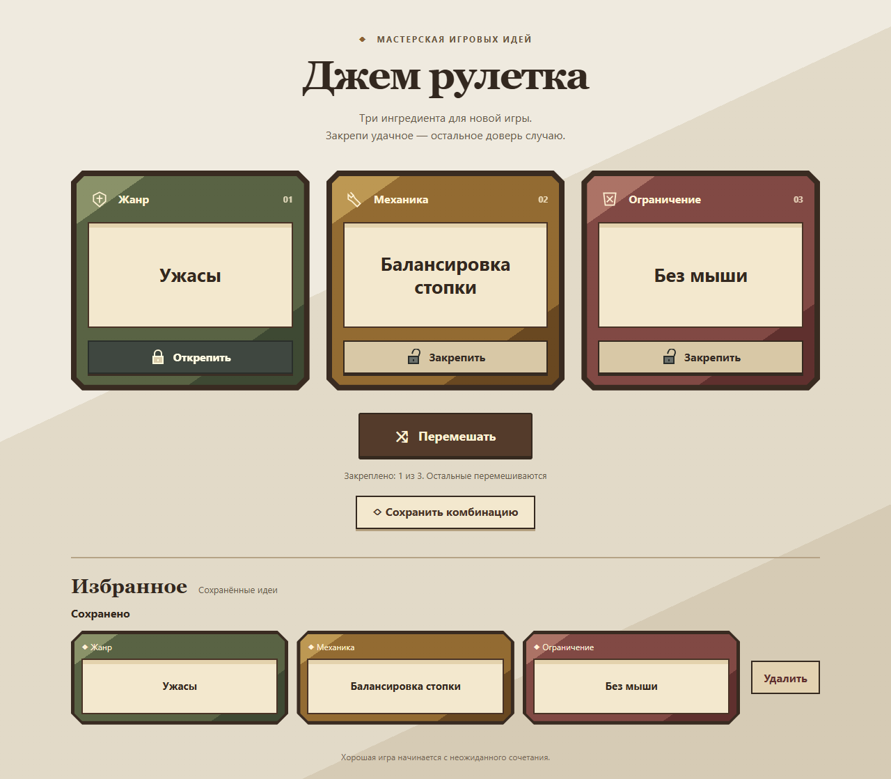

# Jam Roulette

A small game-jam idea generator: roll a genre, a mechanic and a creative constraint, lock the ingredients you like, and save promising combinations.

**[Live demo](https://triton556.github.io/jam-roulette/)** · Russian interface · No account required



## Features

- 60 genres, 60 mechanics and 60 constraints: **216,000 possible combinations**.
- One combination per shuffle. Lock any ingredient to keep it while the others change.
- Save combinations to Favorites, avoid duplicates, and delete individual entries.
- Responsive low-poly medieval cards, keyboard controls and reduced-motion support.

The medieval theme is visual: the catalogs cover many kinds of small games.

## Stack

Plain HTML, CSS and browser-native JavaScript ES modules. No framework, package installation, external assets, backend or build dependency is required. Node.js runs the local preview, tests and static deployment packaging.

## Controls

| Interface label | Action |
| --- | --- |
| Перемешать | Shuffle unlocked ingredients |
| Закрепить / Открепить | Lock / unlock one card |
| Сохранить комбинацию | Save the current combination |
| Удалить | Remove one saved combination |

Use Tab to move between buttons and Enter or Space to activate them. Shuffling is disabled when all three cards are locked.

## Run locally

Install Node.js 24 or later, then run from the repository root:

```sh
node scripts/serve.mjs
```

Open [localhost:4173](http://127.0.0.1:4173/). Stop with Ctrl+C. If the port is already in use, stop the other process before retrying.

## Tests

```sh
node --test tests/generator.test.mjs tests/favorites.test.mjs
```

Seven tests cover catalog counts and preserved entries, initialization, all eight lock combinations, sampling boundaries, input validation, durable Favorites snapshots, duplicates, targeted deletion and storage failures.

For a browser check, try desktop and phone widths, lock a card and shuffle, lock all cards, save a combination, reload, and delete the saved entry.

## Project structure

```text
index.html                     Page structure
styles.css                     Responsive medieval card styling
src/app.mjs                    Generator interface and locks
src/generator.mjs              Catalogs and combination sampling
src/favorites-store.mjs        Versioned browser storage and snapshots
src/favorites-view.mjs         Favorites interface
tests/                         Node behavior tests
scripts/serve.mjs               Local preview server
scripts/build-pages.mjs         Explicit public-artifact packaging
.github/workflows/pages.yml    Test and deploy workflow
```

## Data and limitations

Favorites are stored only in this browser's localStorage under `jam-roulette.favorites.v1`. Each saved entry includes its original ingredient labels. There is no account, cloud synchronization or cross-device transfer.

Browser storage belongs to an origin. Favorites saved on a localhost preview do **not** automatically appear on the HTTPS demo; other browsers and devices have separate lists. The current roll and locks reset on reload. Clearing site data removes saved Favorites.

When storage is unavailable or damaged, the app shows an error instead of silently clearing the data or reporting a failed write as successful. The generator continues to work.

## Deployment

GitHub Pages uses **GitHub Actions**. In repository Settings → Pages, choose GitHub Actions as the publishing source.

A push to `main`, or a manual run of **Test and deploy Pages**, runs the tests, stages the public files, and deploys to:

**https://triton556.github.io/jam-roulette/**

To inspect the same static artifact locally:

```sh
node scripts/build-pages.mjs
```

The generated `.pages-dist/` contains only `index.html`, `styles.css`, the four application modules and `.nojekyll`. Tests, documentation, private local artifacts and development scripts are excluded from the deployed site. Relative asset paths support the `/jam-roulette/` project URL.

Update the app by committing and pushing reviewed changes to `main`; check the Actions run before assuming the live site has updated. To restore a prior version, revert the relevant change and let the workflow deploy that revision.
